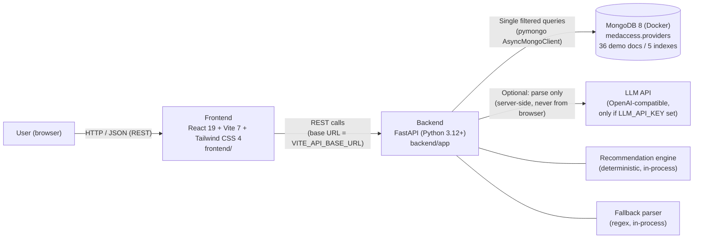
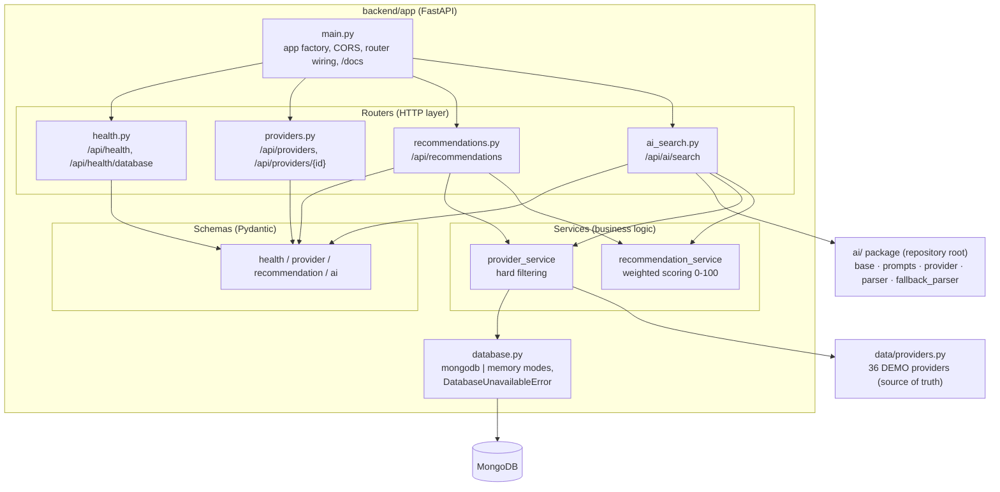
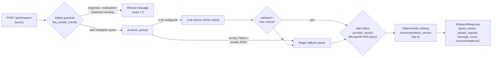
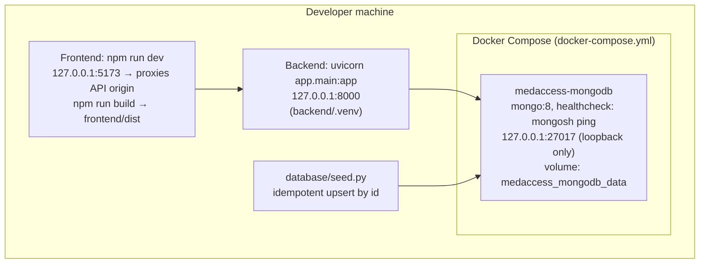

# System Architecture

Diagrams use [Mermaid](https://mermaid.js.org/). They render automatically on
GitHub and in any Mermaid-enabled Markdown viewer (VS Code extensions,
Typora, etc.).

## 1. High-level system context

Key rules visible in this diagram:

- The browser calls **only** the FastAPI backend; no API key ever ships to the
  frontend.
- The LLM (when configured) is called **by the backend**, only to parse the
  user's query into search parameters — never to rank, never to access data.
- If no LLM is configured, parsing degrades to the in-process fallback parser.

## 2. Backend internal structure (layered)

Layering rule: **router → service → database**. Routers never build queries;
services never build HTTP responses. `recommendation_service` is deliberately
FastAPI-free so the algorithm can be unit-tested without a server.

## 3. AI search request pipeline (Stage 7)

`parser` in the response is `"llm"` or `"fallback"`, so the path actually taken
is always visible and testable.

## 4. Deployment topology (local development)

Only MongoDB runs in Docker; backend and frontend run directly on the host.
The database port is bound to `127.0.0.1` so it is never reachable from other
machines in local development.
